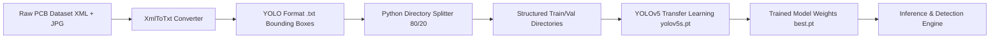

# YOLOv5 PCB Defects Detection & Automated Inspection Pipeline

An end-to-end Computer Vision and Deep Learning pipeline for automated, real-time quality assurance and defect detection on Printed Circuit Boards (PCBs) using Ultralytics YOLOv5.

---

## Table of Contents
- [1. Detailed Explanation of the Project](#1-detailed-explanation-of-the-project)
  - [Problem Statement & Industrial Context](#problem-statement--industrial-context)
  - [The 6 PCB Defect Classes](#the-6-pcb-defect-classes)
  - [End-to-End Technical Pipeline](#end-to-end-technical-pipeline)
- [2. Summary of Tools & Technologies Used](#2-summary-of-tools--technologies-used)
- [3. Deep Dive into Key Tools & Concepts](#3-deep-dive-into-key-tools--concepts)
  - [Ultralytics YOLOv5 Architecture](#1-ultralytics-yolov5-architecture-deep-dive)
  - [Annotation Math: Pascal VOC (XML) to YOLO (TXT)](#2-annotation-math-pascal-voc-xml-to-yolo-txt)
  - [Transfer Learning & Anchor Box Tuning](#3-transfer-learning--anchor-box-tuning)
- [4. Model Training & Selection of best.pt](#4-model-training--selection-of-bestpt)
  - [Training Run Summary](#training-run-summary)
  - [How best.pt Was Selected](#how-bestpt-was-selected)
  - [Exact Training Command Executed](#exact-training-command-executed)
- [5. 10 to 15-Minute Interview Script](#5-10-to-15-minute-interview-script)

---

## 1. Detailed Explanation of the Project

### 🎯 Problem Statement & Industrial Context
In electronics manufacturing, Printed Circuit Board (PCB) quality assurance traditionally relies on manual visual inspection or rule-based Automatic Optical Inspection (AOI) systems. Manual inspection is slow and subject to operator fatigue, while legacy rule-based AOI systems struggle with illumination variations and minor board distortions.

This project implements a Deep Learning-based Real-Time PCB Defect Detection System using YOLOv5. It automates the detection and precise localized bounding-box classification of 6 critical PCB surface defect types.

### 🔬 The 6 PCB Defect Classes
The project uses the public PKU-PCB Dataset (available on Kaggle/Roboflow) containing annotated micro-defects:

- **`missing_hole`**: Drilling failures where vias or component lead holes were omitted.
- **`mouse_bite`**: Edge erosion/nicks on conductive traces causing high resistance.
- **`open_circuit`**: Broken copper traces breaking electrical continuity.
- **`short`**: Excess copper bridging two isolated traces.
- **`spur`**: Pointed copper protrusions extending from a trace line.
- **`spurious_copper`**: Isolated leftover copper specks on non-conductive substrate.

### 🔄 End-to-End Technical Pipeline



1. **Data Acquisition & Format Harmonization**:
   - Raw annotations come in Pascal VOC format (`.xml`).
   - The `xmltotxt.py` tool converts absolute pixel coordinates into normalized YOLO format: `(class_id, x_center, y_center, width, height)`.

2. **Automated Dataset Partitioning**:
   - The script `to_v5_directories()` randomly shuffles pairs of images and labels into an 80% Training set and 20% Validation set split into the strict YOLOv5 folder structure.

3. **YOLOv5 Model Setup**:
   - Configures `dataset.yaml` to point to training/validation paths and map class IDs 0–5.
   - Loads pre-trained COCO weights (`yolov5s.pt`) for fine-tuning via Transfer Learning.

4. **Training & Inference**:
   - Training runs with specified hyperparameters (`--img 416`, `--batch 16`, `--epochs 50`).
   - Generates output logs, confusion matrices, precision-recall curves, and saves optimal checkpoint weights (`best.pt`).
   - Runs `detect.py` to draw bounding boxes and confidence scores over unseen PCB images.

---

## 2. Summary of Tools Used

| Tool / Technology | Purpose in Project |
| :--- | :--- |
| **Python 3.10+** | Core programming language for scripts, automation, and model training. |
| **Ultralytics YOLOv5** | State-of-the-art single-stage object detection model family. |
| **PyTorch** | Deep Learning framework powering model architecture, GPU acceleration, and autograd. |
| **OpenCV (`cv2`)** | Image processing, resizing, color-space conversions, and visualization. |
| **XmlToTxt (`xmltotxt.py`)** | Custom parsing utility for converting XML bounding boxes to YOLO `.txt`. |
| **Shutil & OS** | Python standard libraries for directory traversal, automated random splitting, and file operations. |
| **Jupyter Notebook / Google Colab** | Interactive environment for experimentation, cloud GPU execution, and inline plotting. |
| **YAML (`dataset.yaml`)** | Configuration file standard for defining dataset paths and class labels. |

---

## 3. Deep Dive into Key Tools & Concepts

### 1️⃣ Ultralytics YOLOv5 Architecture Deep Dive
YOLOv5 (You Only Look Once version 5) is a single-stage object detector that processes the entire image in a single neural network pass, predicting bounding boxes and class probabilities directly.

- **Backbone (CSP-Darknet53)**:
  - Uses Cross Stage Partial (CSP) networks to extract rich feature maps at multiple scales.
  - Reduces computational bottlenecks while maintaining gradient flow across layer divisions.
- **Neck (PANet / Feature Pyramid Network)**:
  - Path Aggregation Network (PANet) combines low-level spatial features (crucial for tiny PCB defects like `spur` and `mouse_bite`) with high-level semantic features.
- **Head (YOLO Detection Layer)**:
  - Generates final bounding box predictions across 3 different spatial scales ($13\times13$, $26\times26$, $52\times52$) using multi-scale anchor grids.
- **Loss Functions**:
  - **Box Loss ($\mathcal{L}_{box}$)**: CIoU (Complete Intersection over Union) loss measuring overlap, center-point distance, and aspect ratio alignment.
  - **Objectness Loss ($\mathcal{L}_{obj}$)**: BCE (Binary Cross Entropy) loss evaluating whether an object exists within a grid cell.
  - **Class Loss ($\mathcal{L}_{cls}$)**: BCE loss for multi-class classification.

### 2️⃣ Annotation Math: Pascal VOC (XML) to YOLO (TXT)
Pascal VOC stores absolute pixel coordinates:
$$\text{Box}_{\text{VOC}} = [x_{\min}, y_{\min}, x_{\max}, y_{\max}]$$

YOLO format requires normalized values relative to image width ($W$) and height ($H$):
$$x_{\text{center}} = \frac{x_{\min} + x_{\max}}{2 \cdot W}, \quad y_{\text{center}} = \frac{y_{\min} + y_{\max}}{2 \cdot H}$$
$$\text{width} = \frac{x_{\max} - x_{\min}}{W}, \quad \text{height} = \frac{y_{\max} - y_{\min}}{H}$$

*All values in YOLO `.txt` files are bounded between $[0.0, 1.0]$.*

### 3️⃣ Transfer Learning & Anchor Box Tuning
- **Transfer Learning**: Instead of training millions of parameters from scratch on small datasets (e.g., ~100-500 images), the model initializes weights pre-trained on the 80-class COCO dataset (`yolov5s.pt`). Early feature extractors (edges, textures, shapes) are reused, while the final classification head is re-initialized for the 6 PCB defect classes.
- **Auto-Anchor Verification**: YOLOv5 automatically runs K-Means clustering on the custom dataset's ground-truth bounding boxes to calculate optimal custom anchor box ratios for small PCB flaws.

---

## 4. Model Training & Selection of `best.pt`

### 📊 Training Run Summary
- **Number of Training Sessions (Runs)**: 1 Single Training Session (named `pcb_1st`).
- **Total Epochs Trained**: 50 Epochs (Epoch `0/49` through `49/49`).
- **Total Gradient Steps / Iterations**: 1,750 iterations (35 batches per epoch $\times$ 50 epochs).
- **Total Dataset Processed**: 552 training images and 138 validation images per epoch.

### 🏆 How `best.pt` Was Selected
During the 50 training epochs, YOLOv5 evaluated model accuracy on the 138 validation images at the end of every epoch:

- **Peak Performance Epoch**: At **Epoch 47** (out of 49), the model achieved its highest overall validation score:
  - **mAP@0.5**: **`0.575` (57.5%)**
  - **Precision**: `0.589` (58.9%)
  - **Recall**: `0.657` (65.7%)
- **Checkpoint Generation**: YOLOv5 automatically checkpointed and saved the weights from Epoch 47 to `runs/train/pcb_1st/weights/best.pt`.
- **Difference vs `last.pt`**:
  - `best.pt` (14.4 MB): Saved from **Epoch 47** because it gave the highest mAP@0.5 validation performance.
  - `last.pt` (14.4 MB): Saved from **Epoch 49** (the final epoch of training).

### 💻 Exact Training Command Executed
```bash
python train.py --img 416 --batch 16 --epochs 50 --data dataset.yaml --weights yolov5s.pt --cache --name pcb_1st
```
*Total training time elapsed*: **~6 minutes** (0.099 hours on an NVIDIA Tesla T4 GPU in Google Colab).

---

## 5. 10 to 15-Minute Interview Script

> **Interview Scenario**: You are interviewing for a **Computer Vision / Machine Learning Engineer** position.
> 
> **Participants**:
> - **Interviewer (INT)**: Lead AI Architect / Engineering Manager
> - **Candidate (YOU)**: Candidate presenting the YOLOv5 PCB Defect Detection project

---

### ⏱️ Phase 1: Elevator Pitch & Problem Statement (0:00 - 3:00)

**INT**: *"Welcome! Let's dive straight into your portfolio. Can you explain the PCB Defect Detection project you built with YOLOv5?"*

**YOU**: 
> *"Thank you! In electronics manufacturing, inspecting Printed Circuit Boards for tiny defects is a critical quality control step. Traditional optical inspection methods rely on rigid geometric rules that break under slight lighting changes or surface reflections.*
> 
> *I built an automated deep learning pipeline using YOLOv5 that detects 6 common manufacturing defects: missing holes, mouse bites, open circuits, short circuits, spurs, and spurious copper. The system handles everything from converting raw Pascal VOC XML annotations into normalized YOLO format, partition management, transfer learning with YOLOv5, through to real-time bounding-box inference."*

**INT**: *"Why did you specifically choose YOLOv5 over two-stage detectors like Faster R-CNN or transformer models like DETR?"*

**YOU**: 
> *"PCB inspection on a high-speed production conveyor belt requires ultra-low latency inference—often under 20 to 30 milliseconds per frame. Two-stage detectors like Faster R-CNN provide high accuracy but are computationally heavy and struggle with real-time frame rates.*
> 
> *YOLOv5 strikes an optimal balance: its CSP-Darknet backbone and PANet neck provide strong multi-scale feature fusion for small defects, while operating at over 60 FPS on standard GPUs. Furthermore, Ultralytics YOLOv5 offers native PyTorch export options like ONNX and TensorRT for deployment on edge AI hardware like NVIDIA Jetson."*

---

### ⏱️ Phase 2: Data Engineering & Preprocessing Pipeline (3:00 - 6:00)

**INT**: *"Walk me through how you handled the raw dataset and annotation formatting."*

**YOU**: 
> *"The raw dataset came with Pascal VOC XML files containing absolute coordinates ($x_{\min}, y_{\min}, x_{\max}, y_{\max}$). YOLOv5 requires normalized bounding-box center coordinates and dimensions bounded between 0 and 1.*
> 
> *I wrote a Python automation script using XML parsers to transform these coordinates into YOLO format. Following annotation conversion, I developed a custom dataset partitioner (`to_v5_directories()`) that randomly splits images and labels into an 80/20 train/validation split while maintaining pair integrity, outputting the exact directory tree required by YOLOv5."*

**INT**: *"Did you face any data imbalance issues among the 6 defect classes?"*

**YOU**: 
> *"Yes, in industrial defect datasets, certain defects like `open_circuit` or `short` occur more frequently than rare anomalies like `mouse_bite`. To mitigate class imbalance during training, YOLOv5 uses Focal Loss and automated mosaic data augmentation—stitching 4 random training images into 1. Mosaic augmentation forces the model to detect objects at varying scales and in diverse contextual surroundings."*

---

### ⏱️ Phase 3: Model Architecture & Hyperparameter Tuning (6:00 - 10:00)

**INT**: *"How did you configure the training parameters in your script?"*

**YOU**: 
> *"In the notebook, I initialized training with the command:*
> `python train.py --img 416 --batch 16 --epochs 50 --data dataset.yaml --weights yolov5s.pt --name pcb_1st`
> 
> *I chose an input resolution of 416x416 pixels for fast baseline training, though for production deployment with tiny defects like `spur`, scaling to 640x640 or higher improves recall. I used `yolov5s.pt` (the small variant) as pre-trained weights on COCO to leverage transfer learning."*

**INT**: *"What loss functions does YOLOv5 use to optimize bounding box placement and classification?"*

**YOU**: 
> *"YOLOv5 computes a composite loss consisting of three components:*
> 1. **CIoU Box Loss**: Complete Intersection over Union evaluates overlap area, central point distance, and aspect ratio consistency.
> 2. **Objectness Loss**: Binary Cross-Entropy loss evaluating whether a grid cell contains a defect.
> 3. **Classification Loss**: BCE loss for classifying which of the 6 defect categories is present.*
> 
> *The total loss is a weighted sum: $\mathcal{L}_{\text{total}} = \lambda_{\text{box}} \mathcal{L}_{\text{box}} + \lambda_{\text{obj}} \mathcal{L}_{\text{obj}} + \lambda_{\text{cls}} \mathcal{L}_{\text{cls}}$."*

---

### ⏱️ Phase 4: Challenges, Metrics & Real-World Edge Optimization (10:00 - 13:00)

**INT**: *"What was the most challenging technical hurdle in detecting these PCB defects?"*

**YOU**: 
> *"The biggest challenge was detecting extremely small defects like `spur` (small copper tails) and `mouse_bite` (tiny nicks on trace edges). In standard feature maps downsampled by $32\times$, these features disappear.*
> 
> *To solve this, PANet's bottom-up path augmentation retains high-resolution spatial details from earlier backbone layers. Additionally, anchor box clustering via K-Means recalculated default anchor sizes tailored specifically to the small aspect ratios of PCB defects."*

**INT**: *"How did you evaluate model performance?"*

**YOU**: 
> *"I monitored Mean Average Precision at IoU threshold 0.5 (**mAP@0.5**) as well as **mAP@0.5:0.95**. I also plotted Confusion Matrices to verify that the model did not confuse `open_circuit` with `mouse_bite` due to visual similarity."*

---

### ⏱️ Phase 5: Production Deployment & Wrap-Up (13:00 - 15:00)

**INT**: *"How would you take this prototype notebook and deploy it into a real factory assembly line?"*

**YOU**: 
> *"For a factory production environment, I would execute the following steps:*
> 1. **Export to TensorRT**: Convert the PyTorch model (`best.pt`) to ONNX and then compile it into an FP16/INT8 TensorRT engine for NVIDIA Jetson edge hardware.
> 2. **C++ / CUDA Pipeline**: Wrap OpenCV camera streams in C++ for zero-copy memory frames into GPU buffer space.
> 3. **Non-Maximum Suppression (NMS)**: Apply GPU-accelerated NMS to eliminate overlapping candidate bounding boxes.
> 4. **Integration with Industrial PLC**: Trigger hardware signals via Modbus or MQTT to physically eject defective PCBs off the conveyor belt when a high-confidence defect is detected."*

**INT**: *"Excellent detailed breakdown! Thank you."*

**YOU**: *"Thank you for the opportunity!"*
